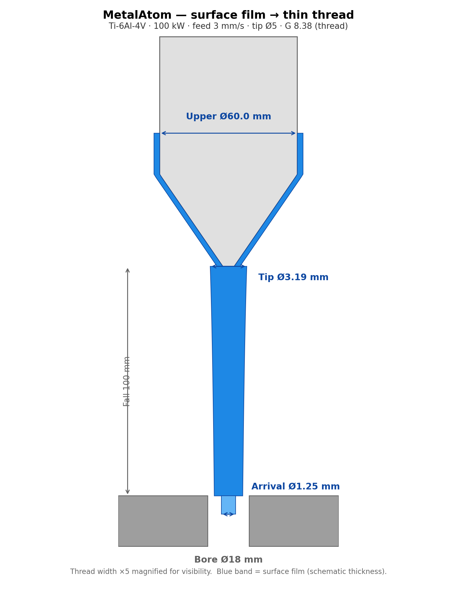
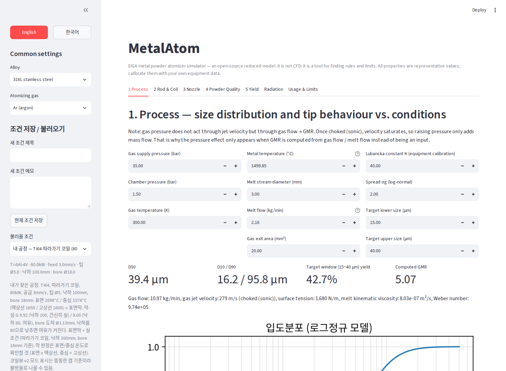
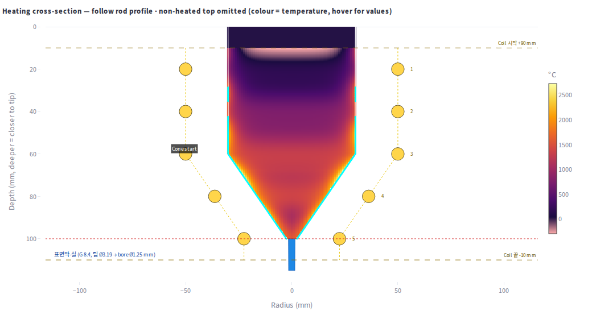
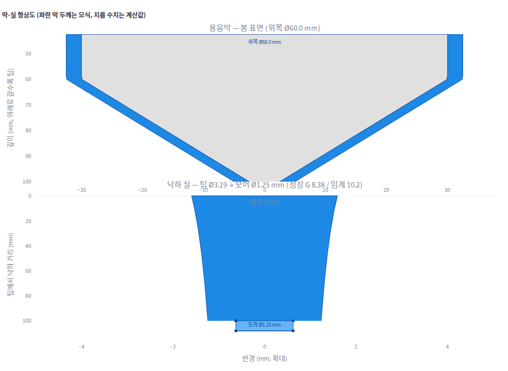
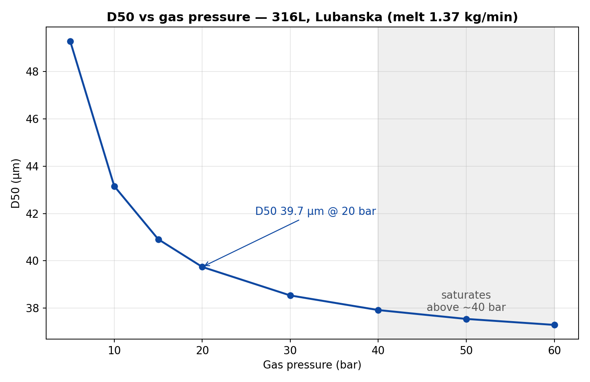
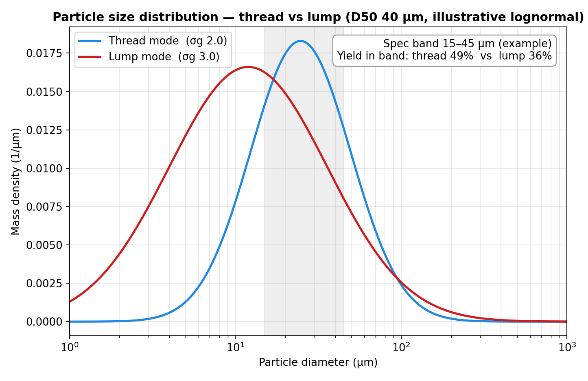

# MetalAtom — Open-Source Gas Atomizer Simulator (EIGA)

MetalAtom is an open-source, simplified simulator for gas atomization of metal
powder (EIGA — Electrode Induction Melting Gas Atomization). It does not try to
reproduce ANSYS. Its purpose is to find the **rules and limits** of the process:
sweep the process conditions and find where powder comes out right — and where it
doesn't.

It was built from field experience operating an ALD EIGA machine, with AI
assistance. See [GLOSSARY.md](GLOSSARY.md) for every term used in the program,
explained with examples.



## What it does

- **Process (Tab 1):** particle size distribution (D50/D10/D90), yield in a target
  size range, gas-to-melt ratio (GMR), parameter sweeps, process-window maps.
- **Rod & coil (Tab 2):** rod feed rate, coil power, coil shape (straight / cone /
  curve taper / follow-shape), rod diameter, tip shape → melt rate, tip
  temperature, melt cap length, detachment mode (droplet / thread).
- **Coil heating view (Tab 2b):** Lagrangian descent thermal model with a radial
  temperature field. See where the rod surface melts and where the core stays solid.
- **Nozzle (Tab 3):** bore diameter (default 18 mm, with a clogging warning at
  ≤ 16 mm), annular slit vs individual holes, jet angle, De Laval bore
  (supersonic), transit time.
- **Powder quality (Tab 4):** cooling / solidification distance, oxidation,
  spheroidization, flowability.
- **Yield (Tab 5):** mass-fraction yield for a passing size range.
- **Radiation:** heat loss from the rod and coil to the chamber walls.
- **Film-thread mode:** when only the rod surface melts (a surface film), the melt
  flows down as a thin thread instead of dripping as blobs. The program draws the
  film and the falling thread at true scale, with the upper diameter and the bore
  arrival diameter.
- **Condition presets:** 31 saved process conditions in the sidebar, each with a
  memo — including the author's own process and the minimum-power conditions for a
  150 mm fall, two per alloy.

## The core idea: surface film → thin thread

Melt only the surface of the rod so it flows down. If the melt supply is enough
to chain the droplets into a continuous stream, it melts like a thread and gets
sucked into the nozzle bore. That is the thread the program is built to find.
Forcibly melting a thick column so it sticks together is not a thread — it is a
fat blob that drips, clogs the nozzle, and gives a broad particle size
distribution. A thin thread gives a narrower, more uniform distribution.

Survival of the thread is judged by a stretch-aware growth integral **G**:
G < 10.2 means the thread reaches the bore; G ≥ 10.2 means it pinches off
mid-fall. See [GLOSSARY.md](GLOSSARY.md) for G, We, bore, and the rest.

## Screenshots

The real app (Streamlit), with the saved condition "Ti64 예시 1" loaded:







## Quick start

```bash
pip install -r requirements.txt
streamlit run app.py
```

Windows: double-click `web_view.bat`. If the browser does not open
automatically, go to `http://localhost:8501`.

Try it: in the sidebar, load **"Ti64 예시 1 — 100kW/공급 3/팁 5"** and look at the
coil heating view — the film thread (blue) with its upper diameter and bore
arrival diameter.

## Physics at a glance

- Lubanska correlation: `D50/D = K·√[(νm/νg)·(1/We)·(1+M/A)]`
  (We on melt density; K = 40 by default, a calibration constant)
- Particle size distribution: lognormal (σg = 2.0 by default)
- Gas jet: choked-flow check + choked mass-flow equation (Cd 0.9)
- Film thread: `v0 = √(2g·L_melt)`; thread diameter from mass balance;
  survival by the stretch-aware growth integral G vs 10.2
- Materials: 316L, 17-4PH, Ti-6Al-4V, Inconel 718, Fe-2Ni. Gases: Ar, N₂, He.

Two rules the model shows:





## Limitations (honest)

- Not CFD: no turbulence, no 3D nozzle flow.
- Properties are representative values — replace them with your alloy's measured
  values.
- K, coil efficiency, and detachment thresholds are calibration parameters.
- The film model is first-order: it ignores film viscosity (real thread may be
  thicker) and gas drag on the film (which would thin it).

## Feedback welcome

If you work with gas atomization, please try it and tell us what matches your
machine and what doesn't — especially melt / no-melt boundaries and detachment
behavior. Open an issue on GitHub.
