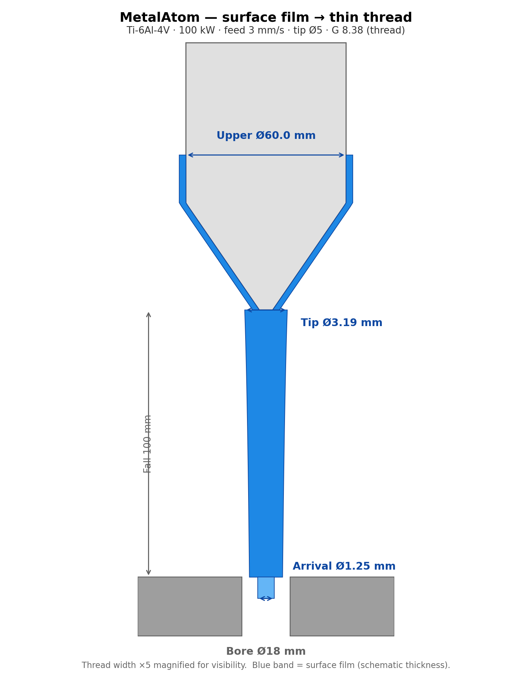
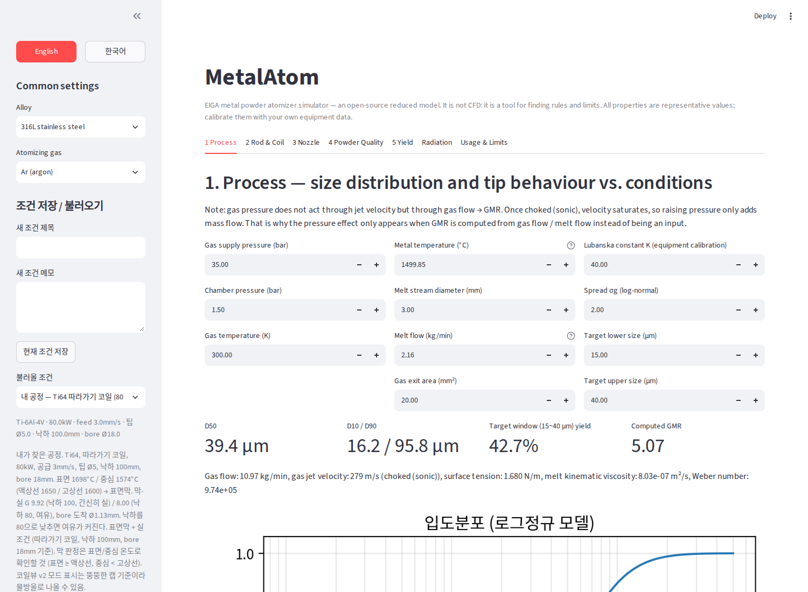
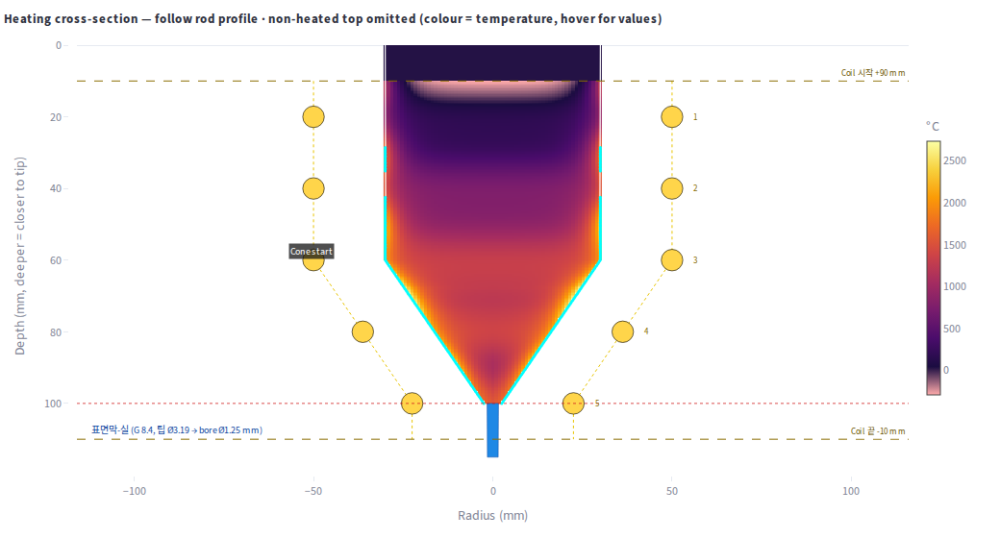
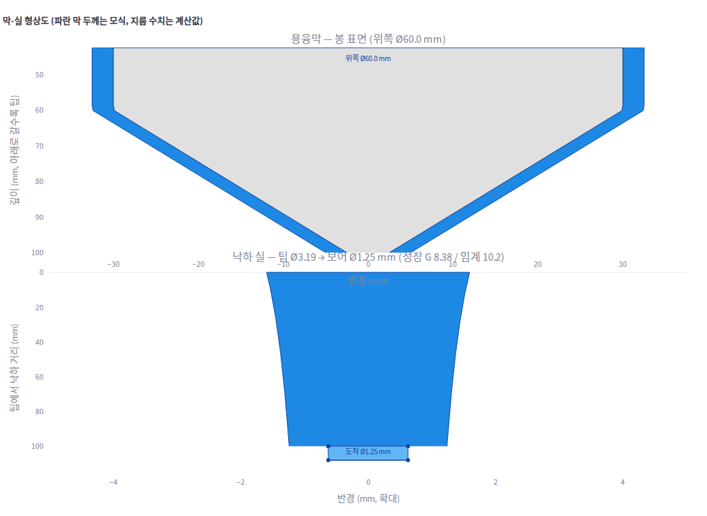
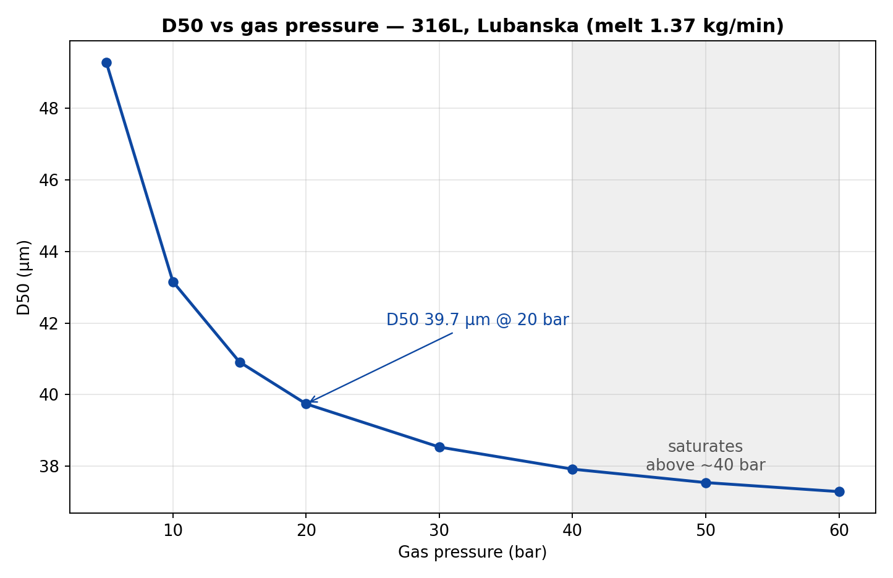
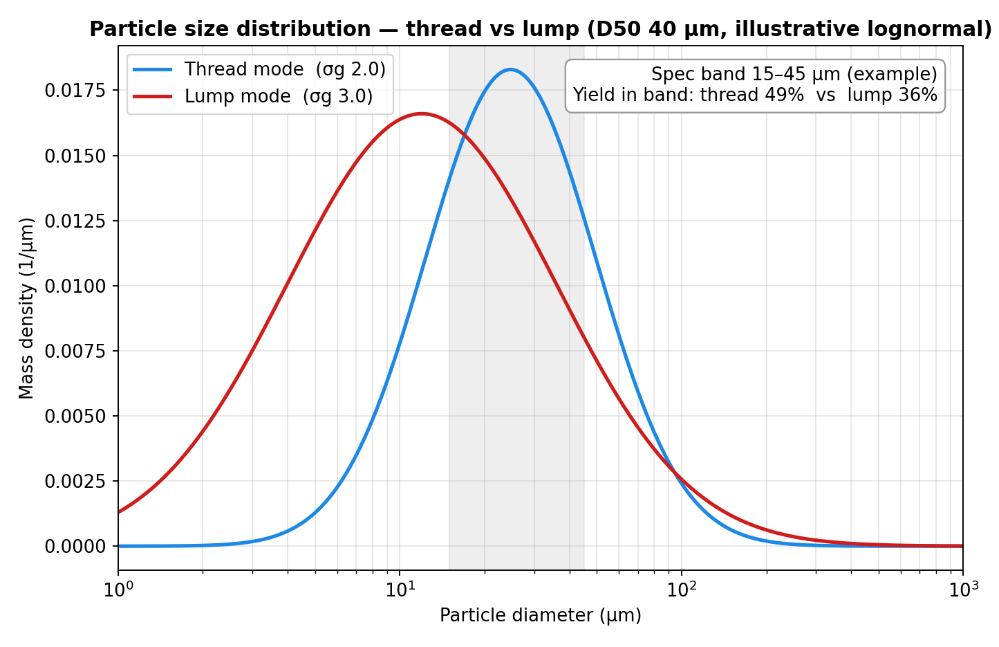

# MetalAtom — 오픈소스 가스 아토마이저 시뮬레이터 (EIGA)

MetalAtom은 금속분말 가스 아토마이저(EIGA — 전극 유도용해 가스 아토마이저)의
오픈소스 간이 시뮬레이터입니다. ANSYS를 그대로 재현하는 것이 목적이 아닙니다.
공정 조건을 바꿔가며 입도분포의 **규칙(Rule)과 한계(Limit)** 를 찾는 도구입니다.

ALD EIGA 장비를 직접 운전한 현장 경험을 바탕으로, AI의 도움을 받아 만들었습니다.
프로그램에 나오는 모든 용어는 [GLOSSARY.md](GLOSSARY.md)에 예시와 함께 설명되어 있습니다.



## 기능

- **1 공정:** 입도분포(D50/D10/D90), 목표 범위 수율, 가스/용탕 비(GMR),
  파라미터 스윕, 공정 윈도우 맵.
- **2 봉·코일:** 봉 공급 속도, 코일 출력, 코일 형상(직선 / 콘 / 곡선 테이퍼 /
  따라가기), 봉 지름, 팁 형상 → 용탕 생성량, 팁 온도, 용융 캡 길이,
  이탈 모드(물방울 / 실).
- **코일 가열 보기 (2b):** 라그랑지안 하강 열 모델 + 반경 방향 온도장.
  봉 표면이 어디까지 녹고, 속은 어디까지 고체로 남는지 볼 수 있습니다.
- **3 노즐:** 보어 지름(기본값 18mm, 16mm 이하에서 막힘 경고),
  환형 슬릿 / 개별 홀, 분사각, 디 라발 보어(초음속), 통과 시간.
- **4 분말 품질:** 냉각 / 응고 거리, 산화, 구형화, 유동성.
- **5 수율:** 통과 입도 범위의 질량분율 수율.
- **복사열:** 봉·코일에서 챔버 벽으로의 복사열 손실.
- **막-실 모드:** 봉 표면만 녹는 경우(표면막), 용탕이 방울로 떨어지지 않고
  얇은 실로 흘러내립니다. 프로그램이 막과 낙하 실을 실제 mm 축척으로 그리고,
  위쪽 직경과 보어 도착 직경을 표시합니다.
- **조건 저장 / 불러오기:** 사이드바에 저장된 공정 조건 31개, 각각 메모 포함.
  만든 사람의 본인 공정과 낙하 150mm 기준 최저 출력 조건(합금별 2개씩)이 들어 있습니다.

## 핵심 아이디어: 표면막 → 얇은 실

봉 표면만 녹여서 흘러내리게 합니다. 녹은 양이 충분해서 작은 물방울들이 이어져
연속된 줄기가 되면, 실처럼 녹아내려 노즐 보어로 빨려 들어갑니다.
이 프로그램은 그 실이 되는 조건을 찾기 위해 만든 것입니다.
굵은 기둥을 억지로 녹여서 붙이는 것은 실이 아닙니다. 뚱뚱한 덩어리가 되어
뚝뚝 떨어지고, 노즐을 막히게 하고, 입도분포를 넓게 만듭니다.
얇은 실은 입도분포를 더 좁고 균일하게 만듭니다.

실이 살아남는지는 신장 고려 성장 적분 **G**로 판단합니다.
G < 10.2면 실이 보어까지 닿고, G ≥ 10.2면 낙하 중에 오그라져 끊어집니다.
G, We, 보어 등 자세한 설명은 [GLOSSARY.md](GLOSSARY.md)를 보세요.

## 스크린샷

실제 앱 화면(Streamlit)입니다. 저장된 조건 "Ti64 예시 1"을 불러온 상태입니다.







## 실행

```bash
pip install -r requirements.txt
streamlit run app.py
```

Windows: `web_view.bat` 더블클릭. 브라우저가 자동으로 열리지 않으면
`http://localhost:8501`로 직접 접속하세요.

먼저 해보기: 사이드바 조건 저장 / 불러오기에서
**"Ti64 예시 1 — 100kW/공급 3/팁 5"** 를 불러오고 코일 가열 보기를 보세요.
파란색 막-실과 위쪽 직경, 보어 도착 직경이 보입니다.

## 핵심 식

- Lubanska 상관식: `D50/D = K·√[(νm/νg)·(1/We)·(1+M/A)]`
  (We는 용탕 밀도 기준, K 기본값 40, 보정 상수)
- 입도분포: 로그정규 분포 (σg 기본값 2.0)
- 가스 제트: 초크(음속) 조건 판정 + 초크 유량식 (Cd 0.9)
- 막-실: `v0 = √(2g·L_melt)`; 질량 보존에서 실 지름 계산;
  신장 고려 성장 적분 G 대 10.2로 생존 판정
- 재료: 316L, 17-4PH, Ti-6Al-4V, Inconel 718, 저합금강(Fe-2Ni).
  가스: Ar, N₂, He.

모델이 보여주는 규칙 두 가지:





## 한계 (솔직하게)

- CFD가 아닙니다. 난류, 노즐 내부 3차원 유동은 풀지 않습니다.
- 물성은 대표값입니다. 본인 합금 실측값으로 교체하세요.
- K 상수, 코일 효율, 이탈 모드 임계값은 보정 파라미터입니다.
- 막 모델은 1차 근사입니다. 막 점성을 무시했고(실제 실은 더 굵을 수 있음),
  막에 작용하는 가스 항력도 무시했습니다(실은 더 가늘어질 수 있음).

## 피드백 환영

가스 아토마이저 현업에 계신 분들, 써보시고 본인 장비와 맞는 부분과 안 맞는 부분을
알려주세요. 특히 용융/비용융 경계와 이탈 거동에 대한 피드백이 가장 도움이 됩니다.
깃헙 이슈로 남겨주세요.
